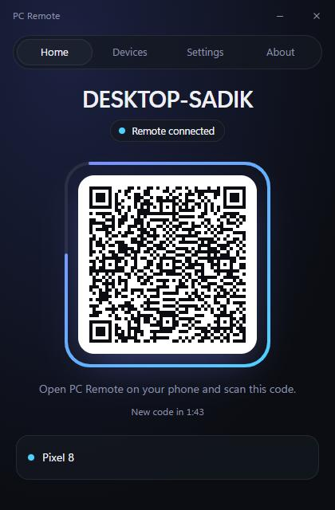
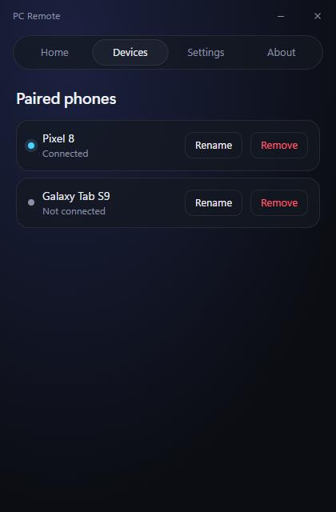
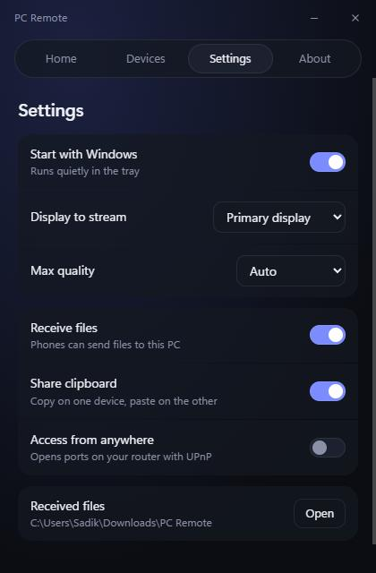
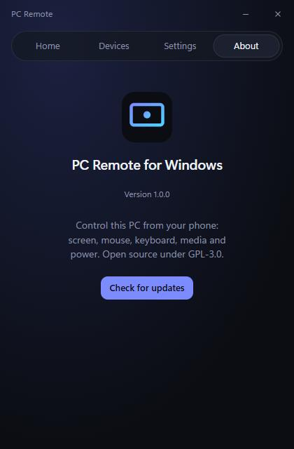

# PC Remote Host (Windows)

The Windows side of PC Remote: a small tray app (Rust + Tauri 2) that pairs phones by QR code, runs the agent from [`docs/protocol.md`](../docs/protocol.md) on TLS port 47999, and drives a hidden Sunshine for screen sharing.

The agent serves mouse and keyboard, media (now playing and volume), gamepads (virtual Xbox 360 via ViGEmBus), files both ways with resume, two-way clipboard, power, live thumbnails and access from anywhere (UPnP). Send a file to your phone from Home, or right-click it in Explorer and choose **Send to phone**.

| Home | Devices | Settings | About |
|---|---|---|---|
|  |  |  |  |

## Build

Needs Rust (MSVC), Node 20+ and the Visual Studio C++ build tools.

```bash
npm install
powershell -File scripts/fetch-deps.ps1   # Sunshine MSI + ViGEmBus into src-tauri/installer/deps
npm run tauri build                       # installer in src-tauri/target/release/bundle/nsis
```

Tests and lint: `cd src-tauri && cargo test && cargo clippy -- -D warnings`.

## What the installer does

Installs per machine, then: installs Sunshine and the ViGEmBus driver if they are missing, opens TCP 47999 in the firewall for the app, lets the tray app restart the Sunshine service, creates hidden Sunshine admin credentials (DPAPI-protected), and starts the app with Windows. Uninstall removes the firewall rule and autostart and asks whether to remove Sunshine.

Data lives in `%APPDATA%\PC Remote`: `store.json` (paired phones as token hashes, settings), `tls.cer`/`tls.key` (the pinned certificate; key DPAPI-encrypted), `sunshine.cred` (DPAPI).

## Measured (v1.0.0, release build)

| | |
|---|---|
| `pc-remote-host.exe` | 5.4 MiB (5,711,360 bytes) |
| Installer (with Sunshine MSI and ViGEmBus) | 37.3 MiB (39,132,399 bytes) |
| Tray idle, 60 s after start | 2.5 MB private working set (18 MB incl. shared DLLs), 0.000 s CPU |
| After opening and closing the window | 4.0 MB private working set, webview processes gone |
| UI script | 3.5 KB gzipped |
